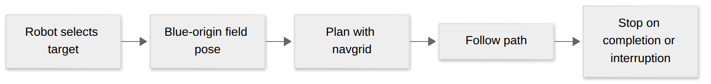

# AutoDrive basics

AutoDrive lets a robot ask the drivetrain to travel to a field pose. The robot project chooses the target, configures the drivetrain and navgrid, and decides when to schedule the command.

[Diagram source](visuals/autodrive-basics.mmd)

- Configure the native pathfinder before configuring the drivetrain for autonomous driving.
- `AutoDriveToPose` samples a supplied target when scheduled. The target uses the blue-origin field frame; the library does not flip it for alliance.
- `AutoDriveTrackTarget` can replan for a moving target. The supplier must reject stale observations.
- Missing or invalid targets stop motion. Releasing, interrupting, or disabling also stops output.
- The navgrid must exist and allow for the robot footprint. Check localization and limits on the real robot.

Read the [full AutoDrive contract](autodrive.md), [public interface](../src/main/include/base/AutoDrive.h), and [implementation](../src/main/cpp/base/drive/AutoDrive.cpp). A season project owns its controller bindings, target selection, and game strategy.
