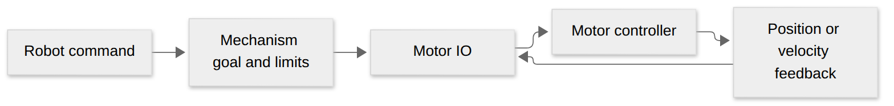

# Mechanism control

## Quick start

Building a shooter or an arm? Start by choosing what you want to control.

[Diagram source](visuals/mechanism-flow.mmd)

1. For a shooter, start with `Flywheel`; for an arm or elevator, use `PositionJoint`. See [Mechanism.h](../src/main/include/base/Mechanism.h).
2. Enter your motor, gearing, units, limits, and gains.
3. Set a goal with `SetVelocity` or `SetPosition`. Decide which command owns the mechanism and what happens when it ends.
4. Check the direction, limits, and gains on the real robot before relying on them.

The details below explain vendor-specific feedback, units, and safety behavior.

`Flywheel` and `PositionJoint` own goals, bounded trajectory references, command
lifetimes, zero references, and safety. `MotorIO` owns closed-loop execution and
feedforward. Real Talon FX and Spark MAX adapters always use onboard control;
`MotorConfig::phoenix.enabled` is retained only for source compatibility and no
longer selects a software loop on real hardware.

`MotorControlConfig` carries gains, physical units, gravity, and joint limits.
`ConfigureControl` returns the execution kind (`true` for firmware, `false` for
the IO emulator); a real configuration failure throws and never falls back to
software. Native reconfiguration requires disabled state, stops first, and
latches failures until a successful disabled reconfiguration. Failed control
requests similarly stop and latch. An arbitrary external encoder callback is
supported by emulated IO, but rejected for real onboard control: use the adapter's
coherent position and velocity feedback instead.

Public gains retain volts and physical mechanism units. Flywheel positions use
output rotations; joint coordinates use `unitsPerOutputRotation` (metres for a
drum circumference). Adapters convert public coordinates to output rotations.
Actual real-adapter neutral-mode changes now require disabled state; repeated
requests for the already-cached mode remain no-ops, including `ResetPosition`
while braking. This avoids synchronous CAN configuration in active control.
Spark runtime CAN timeout is zero; disabled gain/neutral configuration temporarily
uses a checked 250 ms timeout and restores zero even on exceptions.

PID gains must be commissioned on the selected vendor hardware; firmware sample
rates, filtering, integrator limiting, and saturation differ from the emulator.
The conversion is not a promise of identical firmware transients.

- `SetVelocity` sends acceleration-limited references to onboard velocity control.
- `SetPosition` uses ordinary unlicensed Phoenix Motion Magic or REV MAXMotion.
- `SetPositionDynamic` sends the existing bounded software trajectory to onboard
  position control, avoiding synchronous enabled CAN reconfiguration.
- `SetPositionUnprofiled` sends the final position directly.
- Direct voltage and SysId requests override closed-loop control and retain
  physical software limit protection.

## Talon FX

`MotorConfig::gearRatio` maps integrated rotor turns to output turns. For a
CANcoder, select `PhoenixControlConfig::Feedback::RemoteCANcoder`, set
`remoteSensorId`, and set `sensorToMechanismRatio` to sensor turns per output
turn. `sensorReversed` selects the sensor's positive direction. The application
owns CANcoder initialization and offset configuration. Fused/Synchronized feedback
is deliberately not selected because it requires vendor licensing assumptions.
FOC is disabled. Primary inversion is configured on the device; follower reversal
is relative to the primary. Hardware soft limits retain physical coordinates
across `ResetPosition`.

## Spark MAX

The adapter uses REVLib 2026.0.5 `SetSetpoint`, firmware PID, MAXMotion, native
followers, and firmware soft limits. Spark controllers use roboRIO CAN. Primary
encoder position conversion is `1 / gearRatio`; velocity conversion is
`1 / (60 * gearRatio)`, so references are output rotations and rotations/second.
`SparkControlConfig::Feedback::AbsoluteEncoder` selects the attached duty-cycle
absolute encoder with its own sensor/output ratio, zero offset, and direction.
The configured sensor must be physically in phase with positive motor effort.

REV PID output is duty cycle: public voltage-domain PID gains are divided by the
12 V nominal compensation voltage and multiplied by the physical scale.
[REV PID units](https://docs.revrobotics.com/revlib/spark/closed-loop/units) use
milliseconds: the adapter additionally divides integral gain by 1000 and
multiplies derivative gain by 1000 to preserve the public seconds-based contract.
All final converted gains must be finite. REV's
new feedforward gains already use volts; they are not duty-normalized. Native
MAXMotion constraints use converted encoder velocity units. Basic position mode
receives trajectory velocity/acceleration as arbitrary voltage feedforward.
Gravity uses onboard constant/cosine terms where supported; sine gravity (and
non-unit Talon cosine coordinates) is calculated in the adapter from its cached
sensor sample as arbitrary feedforward. This is feedforward, not a roboRIO PID.
No persistent flash writes are performed during runtime configuration. Startup
establishes 20 ms always-on health frames, then acknowledges and confirms cleared
boot reset warnings before the full device configuration
(disabled-only, bounded to 250 ms per motor). Subsequent sticky
reset warnings from the primary or any follower latch the group unhealthy and
stop every motor: a device reset may lose inversion, feedback ratios, followers,
and limits. Restart robot code to rebuild the complete configuration; changing
gains alone cannot recover this fault, and no enabled auto-configuration occurs.

## Simulation and replay

Simulated/injected IO share one explicit-time controller emulator. Its integral,
derivative, and feedforward equations preserve the previous variable-timestep
contract; WPILib's fixed-period PIDController would discard history if recreated
for changing tick durations. Controller state is owned by IO, never by Mechanism.
`Read` is observational, `Control` uses the supplied (including replay-substituted)
snapshot without another sensor read, and only `StepSimulation` advances physics.

Recorded `nativeControl` selects the original source boundary during replay.
Old software-source logs execute the IO emulator and produce the same voltage
request keys; native-source logs recompute `NativeRequest` and compare goals and
profiles. Neither replay nor simulated plants claim to reproduce vendor firmware.
Factories remain lazy: replay constructs no vendor devices or physical plants.

Existing WPILib SysId commands record measured applied voltage/current and stop
on cancellation/completion; they do not need a second characterization API.

Vendor references: [REV closed-loop control](https://docs.revrobotics.com/revlib/spark/closed-loop),
[REV MAXMotion](https://docs.revrobotics.com/revlib/spark/closed-loop/maxmotion-position-control).
Pinned local headers and desktop/roboRIO compilation are the API authority.

### Runtime configuration and scheduler latency

Real motor factories wrap the vendor adapter with a prestarted configuration
worker. Construction and the first gain configuration are synchronous startup
operations; construct mechanisms before running the command scheduler. Subsequent
`SetGains` and changed `SetBrake` requests require disabled state, stop the motor,
and submit one bounded job. An overlapping request is rejected, rather than
queued. `ConfigureControl` still returns firmware ownership, not completion.

The worker exclusively owns the vendor device during configuration, including
Spark CAN timeout changes. Scheduler reads, stops, and motor requests use
non-waiting lock attempts; pending/faulted inputs are unhealthy and outputs remain
zero. `MotorInputs::configuration` reports Ready, Pending, or Fault;
`configurationFailure` identifies failed gains/brake/coast operations. Failures and
an observed enable transition during a job latch Fault. Retry the failed
operation while disabled to recover: gains after a gain failure, or the exact
failed brake/coast target after a neutral failure. Switching operation kind or
neutral target cannot clear partially applied device configuration. Requests made while inhibited are discarded;
completion never resumes a prior goal. Issue a fresh command after observing a
Ready control tick. Destruction joins the worker and belongs to robot lifecycle,
not command execution. This avoids deliberate device-acknowledgement waits;
short vendor/cache locks and OS scheduling still prevent a hard real-time claim.
