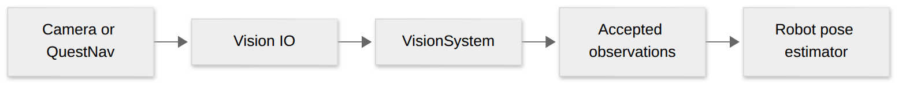

# Localization configuration

## Quick start

Adding a camera or QuestNav? The goal is to get useful observations into your robot’s pose estimator.



[Diagram source](visuals/localization-flow.mmd)

1. Measure and configure each camera or QuestNav mount relative to the robot.
2. Give `VisionSystem` the `VisionIO` adapters and an observation consumer.
3. Set filters and uncertainty. Check that the estimated field pose makes sense.
4. Keep the system alive and run the scheduler. See [Vision.h](../src/main/include/base/Vision.h) and the example below.


Both Limelight and PhotonVision accept `VisionConfig` minimum tag count,
optional allowed tag IDs and minimum count of allowed IDs. Whitelisting gates
observations; it does not alter an already solved camera pose. Empty ID lists
retain the original behavior. Ambiguity gates remain active for single-tag solves;
MegaTag2 retains its heading-assisted exemption and infinite yaw uncertainty.

Covariance remains distance squared / tag count, multiplied by configurable
linear/angular baselines and a per-camera factor. MegaTag2 has an additional
linear factor, default 1 to preserve prior C++ behavior (Java's .5 is an optional
tuning choice). These are estimator uncertainties, not measured accuracy claims.
Replay retains the existing accepted-observation boundary: it reruns downstream
localization/control, not camera solving or these upstream acceptance filters.

## Acquisition adapters

`VisionIO` is a vendor-free acquisition contract. `VisionSystem` owns one or more
IO objects and a reusable `VisionInputs` batch for each. Each scheduler tick calls
each source once, then forwards observations in source order and packet order;
it does not copy or sort batches, create threads, or add replay envelopes.
`Inputs(index)` is a passive snapshot. Connection/yaw getters on the legacy
`Vision`, `PhotonVision`, and `QuestNav` facades now read that snapshot and update
when `Periodic()` runs. These facades register only one subsystem apiece.

Use `MakeLimelightVisionIO`, `MakePhotonVisionIO`, or `MakeQuestNavVisionIO` to
compose multiple sources in one `VisionSystem`. `AlignToField(index, pose)` aligns
a QuestNav source. Cameras retain their accepted-observation replay inputs, while
QuestNav retains raw packets and re-executes decoding and alignment. Factories do
not construct camera/NT devices during replay. `InjectedVisionIO` supplies typed
observations for deterministic tests or model simulation, without image physics.
Its callback fills the existing batch; it must set applicable status fields each
tick. Clear batches retain their allocated capacity.

```cpp
std::vector<std::unique_ptr<base::VisionIO>> sources;
sources.push_back(base::MakeLimelightVisionIO(cameraConfig));
sources.push_back(base::MakeQuestNavVisionIO(questConfig));
base::VisionSystem localization(std::move(sources), observationConsumer);
```
